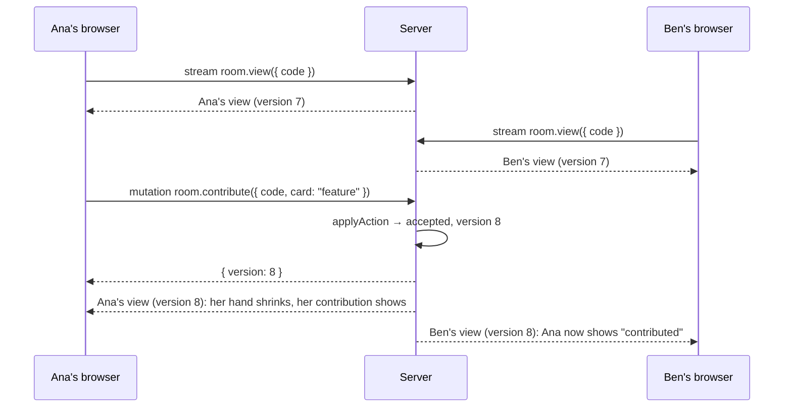

# Architecture

**Status:** approved on 2026-11-11. The routes, RPC surface, rules engine signatures, `PlayerView` shape and hidden-information mapping below are agreed; a material change to any of them needs approval again. The same day the server runtime changed from an Express process to one Durable Object on Cloudflare ([D9](decisions.md#d9-hosting-the-whole-app-in-one-durable-object-on-cloudflare)). The walking skeleton (slice 2) is their first consumer. Later the same day `lastReveal.outcome` was added to the view ([D15](decisions.md#d15-digital-the-reveal-shows-its-outcome)), and each accepted action started returning the room's version ([D17](decisions.md#d17-an-accepted-action-returns-the-rooms-version)).

## Principles

- **The server is the source of truth.** It owns every room and game. Clients send intentions (one RPC per action) and render the view the server pushes. A client never computes game state.
- **The server enforces, the client prevents.** The rules engine on the server rejects every invalid action. The UI disables what's invalid only so players don't send it; it's never trusted.
- **Each player gets only their view.** Hidden information is removed on the server, per player, before anything leaves it ([Hidden information](#hidden-information)).
- **The rules are pure and deterministic.** Randomness comes from a seed stored with the game, so a game can be replayed exactly from its seed and action log. Tests, bug reports and verification all build on that.

## Stack

Pinned as of 2026-11-11.

| Part         | Choice                                                                                                                                                                                                                    |
| ------------ | ------------------------------------------------------------------------------------------------------------------------------------------------------------------------------------------------------------------------- |
| Framework    | Angular 22.2 with server rendering, built with Node 24                                                                                                                                                                    |
| Routing      | `@loozo/angular-router` 0.0.8: filesystem routes with typed parameters                                                                                                                                                    |
| Server calls | `@loozo/angular-launch` 0.0.6: typed queries, mutations and streams colocated with routes                                                                                                                                 |
| UI           | `@loozo/origami-ui` 0.0.4 (headless behavior) and `@loozo/fold-ui` 0.0.2 (styled parts, Tailwind CSS 4)                                                                                                                   |
| Validation   | zod schemas for every action, shared by the client and the server                                                                                                                                                         |
| Server       | Launch's neutral (fetch) server entry inside one fixed-name Cloudflare Durable Object, rooms in its memory; a Worker forwards every request except static files to it, and Workers Static Assets serves the browser files |
| Access       | Cloudflare Access with email one-time PINs ([D10](decisions.md#d10-private-access-cloudflare-access-with-email-one-time-pins))                                                                                            |

## Routes

| Route          | Page                                    | RPC group                                         |
| -------------- | --------------------------------------- | ------------------------------------------------- |
| `/`            | Create a room, or join one by its code  | `lobby`: `createRoom`, `joinRoom`                 |
| `/rooms/:code` | The room: waiting list, game and result | `room`: `view` stream and one mutation per action |

## How a change reaches players



- **Actions** are mutations. Each returns `{ version }`, the room's version right after it, or a declared error such as `WRONG_PHASE` or `CARD_NOT_IN_HAND`. A rejected action fails only that call and changes nothing. A control stays disabled until its page's view reaches the returned version, so it can't be used again on a view that doesn't show its action yet.
- **Views** come from one stream per player. It yields the player's current view first, then a fresh view after every accepted action in the room. Because each value is a full snapshot, a reconnect loses nothing: the handler starts over and yields the current view.
- Launch's `connect()` follows the stream as signals in the room page. It doesn't reconnect on its own, so the page shows its status and calls `reconnect()` when it fails.

The stream handler waits for the room's version to move past the one it last sent, so a change between a `yield` and the next wait isn't missed:

```ts
view: stream({
  input: roomCodeSchema,
  use: [seated],
  handler: async function* ({ context, input, signal }) {
    const room = context.rooms.get(input.code);
    let sentVersion = -1;

    while (!signal.aborted) {
      if (room.version > sentVersion) {
        sentVersion = room.version;
        yield viewFor(room, context.player.id);
      }

      await room.changedSince(sentVersion, signal); // resolves at once if the version already moved
    }
  },
}),
```

## State ownership

| State                                        | Owner                                                                                       |
| -------------------------------------------- | ------------------------------------------------------------------------------------------- |
| Rooms, players, games, seeds and action logs | The Durable Object's memory: a `Map` from room code to room                                 |
| Who you are                                  | An `httpOnly` session cookie with a random id; the server maps it to your seat in each room |
| The current view                             | Server-computed; the client only renders the latest one                                     |
| Form input, open dialogs, the selected card  | The client                                                                                  |

Launch has no cookie reader, so the context parses the `Cookie` header itself. One session cookie per browser profile means one seat per browser profile, so testing five players takes five separate browser contexts.

## Rules engine

Plain TypeScript with no Angular or Launch imports, so it runs in tests, the server and a simulator alike.

```ts
function applyAction(game: Game, playerId: PlayerId, action: Action): Game | RuleError;
function viewFor(room: Room, playerId: PlayerId): PlayerView;
```

- `Action` is a zod-validated tagged union: `contribute`, `nominate`, `vote`, `finishRetro`, and in the lobby `startGame`.
- Cards are **types, not instances**: a hand is a list such as `["feature", "feature", "status"]`, and `contribute({ card: "feature" })` plays one of them. With no card ids, a revealed card can't be traced back to who was dealt it.
- The seed and the action log live with the room. Replaying `(seed, players, actions)` reproduces the game exactly.

## The view

```ts
type PlayerView = {
  code: string;
  version: number;
  phase: 'lobby' | 'contribute' | 'retro' | 'ended';
  sprint: 1 | 2 | 3 | 4;
  board: { progress: number; target: number; morale: number; debt: number; auditsLeft: number };
  demand: DemandType | null;
  pastDemands: DemandType[];
  me: {
    playerId: PlayerId;
    role: 'plant' | 'delivery' | null; // null in the lobby
    hand: CardType[];
    contribution: CardType | null; // this sprint, until the reveal
  };
  players: {
    playerId: PlayerId;
    name: string;
    isHost: boolean;
    handSize: number;
    hasContributed: boolean;
    isAudited: boolean;
  }[];
  lastReveal: {
    sprint: number;
    cards: CardType[]; // shuffled server-side, unattributed
    mine: number | null; // index of my card in `cards`
    audited: { playerId: PlayerId; card: CardType } | null;
    oneRemoved: boolean; // true under The Sprint Is Now One Week; the card itself is never sent
    outcome: {
      progress: number; // Progress the revealed cards added, after Workshop reductions
      demandMet: boolean | null; // null when the demand has no requirement
      incident: boolean;
    };
  } | null;
  vote: {
    nominee: PlayerId;
    voted: PlayerId[]; // who has voted so far, not how
    mine: boolean | null;
    outcome: { passed: boolean; yes: PlayerId[]; no: PlayerId[] } | null; // once everyone has voted
  } | null;
  retroReady: PlayerId[];
  result: { winner: 'delivery' | 'plant'; roles: Record<PlayerId, 'plant' | 'delivery'> } | null;
};
```

In the digital game, Plan and Contribute are one phase: the team talks on their call while choosing, and the reveal happens as soon as everyone has contributed. A placed card is final, as on paper.

What some fields mean in each phase ([digital rules](rules.md#digital-game)):

- `players[].isAudited`: in `contribute`, plays face up this sprint; in `retro`, will play face up next sprint (the passed vote's nominee); always false in `ended`.
- `me.contribution` and `players[].hasContributed`: this sprint's placement, only in `contribute`.
- `lastReveal`: the latest reveal. It stays through the retro, the next `contribute` phase and `ended`.
- `vote`: in `retro`, and in `ended` only when a passed audit took Morale to 0 and ended the game, so everyone sees the deciding vote (its `outcome` is then complete, with `passed` true). Null in `ended` otherwise. `voted`, `outcome.yes` and `outcome.no` list players in seat order.
- `retroReady`: only in `retro`, in seat order. `result`: only in `ended`.
- `sprint` stays at the last sprint played once the game has ended.

## Hidden information

Each row of the [rules' visibility table](rules.md#who-sees-what) maps to exactly one place in the view, or to none:

| Rule                                                         | In the view                                                                                                                        |
| ------------------------------------------------------------ | ---------------------------------------------------------------------------------------------------------------------------------- |
| Your role / others' roles until the end                      | `me.role` / `result.roles`, only when `phase` is `"ended"`                                                                         |
| Your hand / others' hand sizes only                          | `me.hand` / `players[].handSize`                                                                                                   |
| Deck order, unused demands, next demand                      | Nowhere                                                                                                                            |
| Your contribution / whether others contributed               | `me.contribution` / `players[].hasContributed`                                                                                     |
| Revealed cards, shuffled and unattributed                    | `lastReveal.cards`, shuffled on the server, never in submission order; `lastReveal.outcome` counts only these and the audited card |
| Which revealed card was yours                                | `lastReveal.mine`, computed per player                                                                                             |
| The audited player's card, attributed                        | `lastReveal.audited`                                                                                                               |
| The card removed by The Sprint Is Now One Week               | Nowhere; only `lastReveal.oneRemoved`                                                                                              |
| Votes: who has voted / your vote / everyone's, once complete | `vote.voted` / `vote.mine` / `vote.outcome`                                                                                        |
| Board, demands revealed so far, nominations                  | `board`, `demand`, `pastDemands`, `vote.nominee`                                                                                   |

Three leaks the design rules out by construction: card ids (there aren't any), submission order (the server shuffles before building `lastReveal`), and votes trickling in (they're withheld until everyone has voted, matching the simultaneous vote on paper).

## Known limits in v0

- **One Durable Object, in memory.** A deploy, a Cloudflare runtime update, or eviction once nobody is connected ends every game in progress. Fine for team sessions; durable storage is out of scope.
- **Absent players block the game.** A player who never contributes stalls the sprint; reloading the page restores their seat through the cookie. No timeouts or seat replacement yet.
- **Six streams per browser over HTTP/1.1.** Browsers allow 6 connections per origin over HTTP/1.1, and each open stream holds one, so a seventh tab in the same browser stalls. Cloudflare serves HTTP/2 to browsers, which lifts it in production; local runs are HTTP/1.1, so tests use separate browser contexts.
- **No in-game chat.** The team talks on their usual call.
- **The room page doesn't render the game on the server.** Streams don't run during server rendering, so the page renders its shell and fills in when the stream connects.

## How we'll verify it

1. **Rules engine:** replay tests from seed and action log against the outcomes [rules.md](rules.md) specifies, one per rule and demand.
2. **Hidden information:** for every step of replayed games and every player, check that the view has no other player's hand, no role before the end, never the removed card, and reveal order independent of submission order.
3. **End to end:** Playwright drives five to seven isolated browser contexts through a full game in the real app.
4. **Team session:** the real thing, on everyone's own devices.
